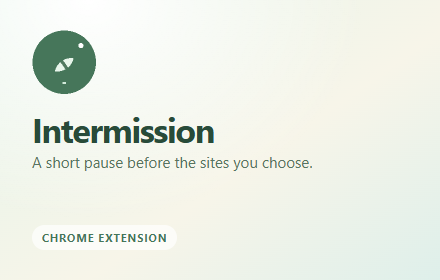
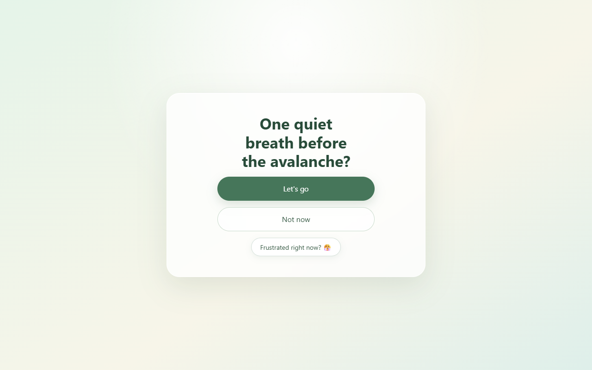

<div align="center">
  

  <h1>Intermission</h1>
  <p><strong>A thoughtful pause before the websites you choose.</strong></p>
  <p>A Manifest V3 browser extension that helps turn an automatic click into a more intentional choice.</p>
  <p><strong>English · বাংলা (Bangla) · Chrome · Brave</strong></p>
</div>

> **Availability:** Intermission is not listed in the Chrome Web Store yet. The versioned manual-install package is available from the [Intermission 1.0.1 GitHub Release](https://github.com/asef-mahir/intermission/releases/tag/v1.0.1).

---

## What Intermission does

Intermission shows a brief, full-screen pause before full page loads on sites you choose. Take a breath, read an interesting fact, use the vent space, or head back to what you meant to do.

- **Your sites, your choice.** Pick the domains where you want a pause.
- **A little room to reset.** Optional five-minute breathing with a count-up timer, an interesting fact, and a clear return path.
- **Gentle check-ins.** The current full-screen check-in after repeated “Not now” choices, plus an optional active-time check-in.
- **English and Bangla.** New installs follow the browser language when it is Bangla and otherwise default to English. You can change language in settings.
- **User-controlled access.** Approve access for selected sites; turn a site off or remove it to revoke that site's access.
- **No accounts or analytics.** No ads, remote code, or developer-operated data server.

## Preview

<p align="center">
  
</p>

Explore more captures in [`store/screenshots/`](store/screenshots/).

## Install in Chrome or Brave

Until the Chrome Web Store listing is available, install Intermission from its versioned GitHub Release package. [Download `intermission-1.0.1.zip`](https://github.com/asef-mahir/intermission/releases/download/v1.0.1/intermission-1.0.1.zip) and extract it.

1. Open your browser's extensions page:

   | Browser | Extensions page |
   |---|---|
   | Google Chrome | [`chrome://extensions`](chrome://extensions) |
   | Brave | [`brave://extensions`](brave://extensions) |

2. Turn on **Developer mode** and select **Load unpacked**.
3. Choose the extracted package folder—the folder where `manifest.json` is directly visible (for example, `…/intermission-1.0.1/manifest.json`). Choose the folder, not the ZIP file or its parent folder.
4. Open Intermission's popup, select **Settings**, and review the first-run disclosure.
5. Choose your language and sites. Grant host access when the browser asks.
6. Open or refresh a selected site to see Intermission.

The manual installation uses the browser's built-in extension manager. To update, either replace the files in the same folder and select **Reload** on the extensions page, or remove the old unpacked copy and load the newly downloaded release folder. Manual installs do not update automatically.

## Browser compatibility

| Browser | Compatibility |
|---|---|
| Google Chrome | Primary target; tested in an isolated Chrome profile. |
| Brave | Tested by loading the extracted extension package with **Load unpacked**; confirmed working. |
| Other Chromium-based browsers | May be compatible; not yet tested in this project. |
| Firefox | Not currently supported. |

## Behavior by design

- Intermission runs on **full page loads and refreshes** of enabled sites. It does not intercept SPA or other in-page navigation.
- Breathing remains five minutes, uses a count-up timer, and offers “Do it again.”
- The existing full-screen check-in is retained.
- Turning a site off or removing it revokes that site's host access. Turning it on again asks for access again.
- Turning the whole extension off keeps access for configured sites, so you can resume without approving each site again.
- Incognito/private windows are not supported in version 1.x.

## Privacy and permissions

Intermission keeps its data in Chrome's built-in storage and does not send it to the developer.

- **Settings**—including the chosen sites, language, and check-in preferences—are saved in `chrome.storage.sync`. Chrome may sync them according to your Chrome sync settings.
- **Small local records**—such as cooldown timestamps, daily check-in counts, active seconds, and the first-run disclosure consent version—are saved in `chrome.storage.local` on your device.
- Intermission reads the current hostname to match it against your chosen sites. It does not store a list of visited pages, full URLs, page titles, page content, search terms, or vent text.
- For the optional active-time check-in, it counts active seconds on a selected site. It does not record keystrokes, clicks, mouse positions, or an interaction timeline.
- No accounts, analytics, advertising, or developer servers are used.

| Permission | Why it is needed |
|---|---|
| `storage` | Save settings and small counters. |
| `scripting` | Register the pause script and inject it into tabs that are already open when needed. |
| Optional host access | Show the pause on sites you choose and enable. |

Read the full [privacy policy](https://asef-mahir.github.io/intermission/privacy.html).

## Built for a considerate pause

- **Manifest V3 service worker** manages content-script registration and cleanup.
- **Optional, user-approved host permissions** keep site access tied to the sites a person enables.
- **Accessible overlay** uses keyboard focus management and separates the pause from the underlying page while it is open.
- **Fail-open behavior** is designed to reveal the page if the pause script cannot finish starting.
- **English and Bangla content banks** keep interface copy and fact content organized by language.
- **Dependency-free packaging checks** validate the extension files and produce a reproducible upload ZIP.

## Build and publish the package

Building is for contributors; it is not required to install a published release package. It requires Node.js 18 or later and has no npm dependencies.

```sh
node scripts/build.js
```

The build creates:

- `dist/unpacked/` — a clean folder for **Load unpacked**.
- `dist/intermission-1.0.1.zip` — the versioned extension package for distribution.

To publish a future manual-install package after its source commit is pushed:

1. In GitHub, open **Releases → Draft a new release** and create tag `v1.0.1` from the finalized `main` branch.
2. Attach `dist/intermission-1.0.1.zip` as the release asset and publish the release.
3. Keep `dist/` out of git; the ZIP belongs as a versioned release asset, not a source file.

The GitHub Release makes the package easy to find and keeps it tied to a version. Users still need to extract it and select the package folder with **Load unpacked**. Automatic browser installation and updates are available only if Intermission is later published in a browser extension store.

Validate without creating build outputs:

```sh
node scripts/build.js --check
```

The validation checks the manifest and referenced files, JSON, icon dimensions, English/Bangla content parity, remote-code patterns, and ZIP contents.

## Project structure

| Path | Purpose |
|---|---|
| `manifest.json` | Manifest V3 configuration and extension entry points. |
| `background.js` | Content-script registration, open-tab injection, permission lifecycle, and cleanup. |
| `storage.js` | Settings defaults, normalization, and domain helpers. |
| `interceptor.js` | Pause overlay, breathing, facts, check-ins, and return paths. |
| `interceptor.css` | Page-cover styling and CSS fail-open behavior. |
| `popup.*`, `options.*` | Toolbar popup, settings, and first-run disclosure. |
| `content/en.json`, `content/bn.json` | English and Bangla interface copy and fact banks. |
| `scripts/build.js` | Dependency-free validation and packaging. |
| `docs/` | Project landing page and privacy policy. |
| `store/` | Store listing materials, screenshots, and capture tooling. |

## Verification

The 1.0.1 build has been tested in an isolated Chrome profile for the core pause flow, breathing, fact reveal, check-ins, language switching, keyboard focus handling, already-open tab injection, permission cleanup, fail-open behavior, strict-CSP rendering, and clean-profile package installation. The unpacked package has also been manually loaded and confirmed working in Brave.

## Project links

- [Project home](https://asef-mahir.github.io/intermission/)
- [Privacy policy](https://asef-mahir.github.io/intermission/privacy.html)
- [Issues and feature requests](https://github.com/asef-mahir/intermission/issues)
- [GitHub Releases](https://github.com/asef-mahir/intermission/releases) — manual-install packages
- **Chrome Web Store:** not listed yet

---

<p align="center"><sub>Intermission 1.0.1 · A little room for a more intentional next click.</sub></p>
